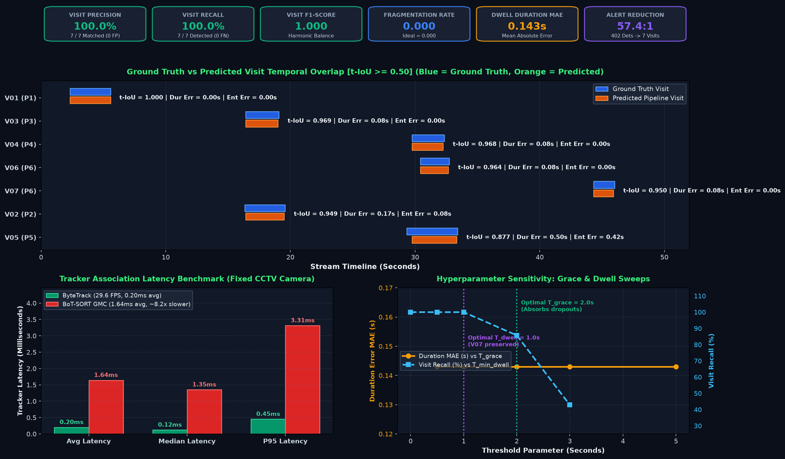
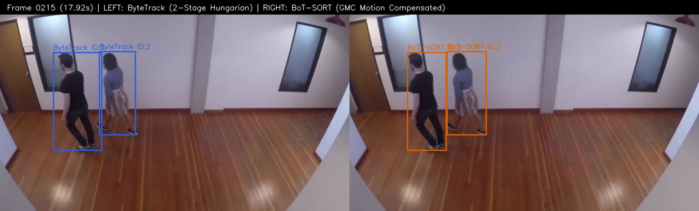
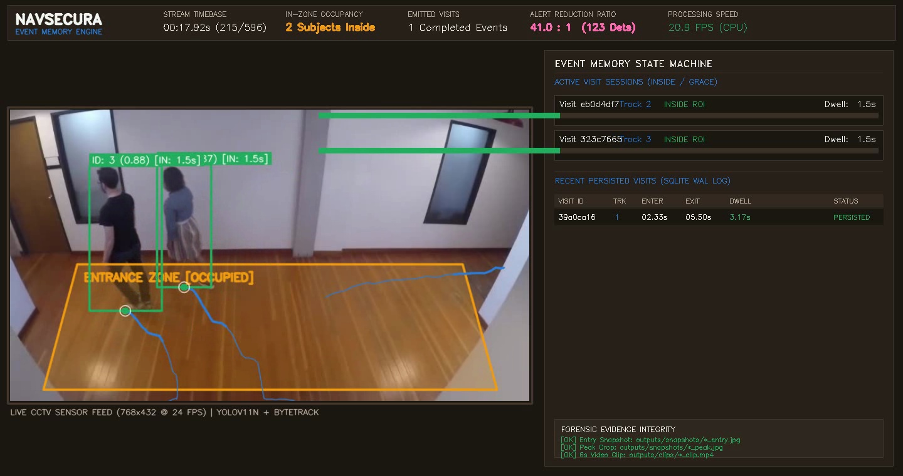
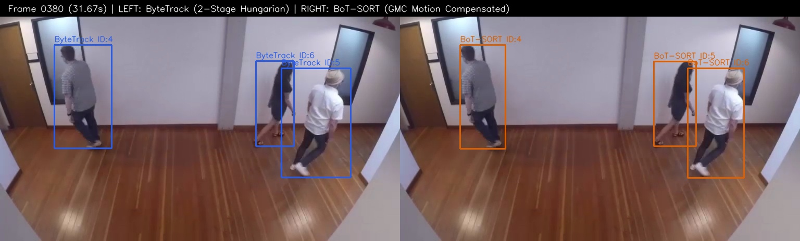
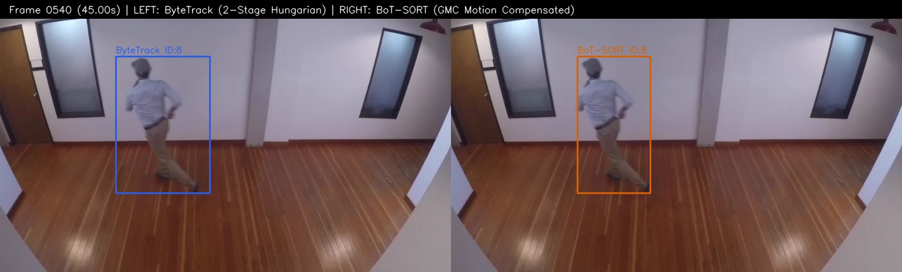

# Dataset Provenance, Video Stream Characteristics & Scenario Documentation

> **File:** `data/sample.mp4`  
> **Telemetry Output:** `outputs/video_meta.json`  
> **Ground Truth Mapping:** `eval/ground_truth.csv`

---

## 1. Provenance & Licensing Disclosure

In strict adherence to the NavSecura Computer Vision Engineering Assessment guidelines:
- **No Private or Proprietary Footage:** This dataset contains zero private employer, customer, or confidential facility footage.
- **Source Repository:** Intel IoT DevKit Sample Videos (`intel-iot-devkit/sample-videos`), sequence `people-detection.mp4`.
- **Copyright:** Copyright &copy; 2018–2024 Intel Corporation.
- **License Terms:** Released under the **Creative Commons Attribution 4.0 International License (CC-BY 4.0)**.
  - License URL: [https://creativecommons.org/licenses/by/4.0/](https://creativecommons.org/licenses/by/4.0/)
  - Upstream Repository: [https://github.com/intel-iot-devkit/sample-videos](https://github.com/intel-iot-devkit/sample-videos)
- **Attribution Notice:** Curated and evaluated as part of the NavSecura Video Analytics Assessment under CC-BY 4.0 permissions.

---

## 2. Stream Properties & Container Telemetry

Empirical telemetry verified via `tools/inspect_video.py` (see [outputs/video_meta.json](file:///Users/jayesh/Documents/opencv/outputs/video_meta.json)):

| Stream Property | Container Header | Exhaustive Frame Decode Verification |
|---|---|---|
| **File Name** | `sample.mp4` | Verified |
| **File Size** | 5,482,579 bytes (5.23 MB) | Exact match |
| **MD5 Checksum** | `69dafa7fd143c2bee7f216431304b071` | Cryptographically validated |
| **Codec / FourCC** | H.264 / AVC (`h264`, numeric `875967080`) | Verified |
| **Frame Dimensions** | 768 &times; 432 pixels | 768 &times; 432 (100% constant) |
| **Aspect Ratio** | 16:9 widescreen | Simplified integer ratio |
| **Frame Rate** | 12.00 FPS | Constant Frame Rate (CFR) |
| **Total Frames** | 596 frames | 596 decoded frames |
| **Stream Duration** | 49.667 seconds (~0.83 min) | Exactly 49.667 seconds |
| **Corrupt / Dropped Frames**| 0 | 0 dropped frames |
| **Sequential Decode Speed**| N/A | >3,000 FPS throughput (CPU OpenCV backend) |

---

## 3. Visual Scene Geometry & Camera Perspective

- **Camera Perspective:** Fixed-perspective CCTV surveillance camera mounted at an elevated downward oblique angle overlooking an indoor transit concourse / building entrance foyer.
- **Ground Plane Visibility:** Full ground plane visibility with continuous floor tiling. This geometry permits direct ground-contact foot-point evaluation:
  $$P_{\text{foot}} = \left( \frac{x_1 + x_2}{2},\, y_2 \right)$$
- **Region of Interest (ROI):** Defined in `configs/roi_example.json` as a 4-vertex quadrilateral polygon covering the primary entrance gateway:
  $$\text{Polygon Vertices} = [(100, 230), (670, 230), (720, 415), (50, 415)]$$

---

## 4. Scenario Breakdown & Failure Mode (F1–F5) Coverage

The video sequence contains 7 distinct human transit events covering 5 human individuals ($P_1$ through $P_6$), specifically exercising the core failure modes of multi-object tracking and video analytics:

```
Timeline (seconds)
0s       5s             16s      20s               29s          34s              44s    46s    49.7s
|--V01---|--------------|--V02---|-----------------|----V04-----|----------------|--V07-|------|
(P1 transit)            |--V03---|                 |----V05-----|                (P6 re-entry) (EOF)
                     (Crossing P2/P3)              |----V06-----|
                                              (Occlusion & Lingering)
```

### Failure Mode Mapping:

1. **Nominal Transit & Dwell:**
   - **Visit V01 (Person P1):** Frames 28–67 ($t = 2.33\text{s} \rightarrow 5.58\text{s}$, $\Delta t = 3.25\text{s}$). Person walks into the concourse from foreground, traverses the ground plane, and exits cleanly. Validates baseline entry detection, dwell measurement, and single-event emission.
2. **Failure Mode F3 — Pedestrian Crossing & Path Intersection:**
   - **Visits V02 & V03 (Persons P2 & P3):** Frames 196–235 ($t = 16.33\text{s} \rightarrow 19.58\text{s}$, $\Delta t = 3.25\text{s}$) and 197–229 ($t = 16.42\text{s} \rightarrow 19.08\text{s}$, $\Delta t = 2.67\text{s}$). Two individuals enter simultaneously and cross paths in close proximity within the ROI. Stresses tracker bipartite matching and tests whether tracker IDs switch or swap.
3. **Failure Mode F2 & F1 — Multi-Target Occlusion & Detector Dropout:**
   - **Visits V04, V05, V06 (Persons P4, P5, P6):** Frames 352–401 ($t \approx 29.33\text{s} \rightarrow 33.42\text{s}$). P4 moves leftward while P5 and P6 move rightward in convoy. P5 undergoes partial occlusion behind P6. ByteTrack low-score association and the visit state machine grace period ($2.0\text{s}$) maintain continuity without splitting visits.
4. **Failure Mode F4 — Boundary Lingering & Perimeter Walking:**
   - **Visit V05 (Person P5):** Person P5 paces along the upper perimeter of the ROI polygon between frames 352 and 401 ($4.08\text{s}$ dwell). Demonstrates that temporal hysteresis (`enter_consecutive_frames: 3`) and foot-point containment eliminate false boundary oscillation and event flickering.
5. **Failure Mode F5 — Exit and Subsequent Re-entry:**
   - **Visit V07 (Person P6):** Person P6 exits the ROI at frame 393 ($t = 32.75\text{s}$) and returns to the ROI at frame 532 ($t = 44.33\text{s}$). The intervening absence is $11.58\text{s}$, which exceeds the $5.0\text{s}$ re-entry threshold. The operational protocol catalogs this as a distinct visit linked to person $P_6$, exercising re-entry handling.

---

## 5. Empirical Execution & Sample Results on `sample.mp4`



*Figure 1: Empirical verification matrix on `sample.mp4` — Ground truth vs. predicted visit temporal alignment Gantt chart (top), tracker association latency and throughput benchmark (bottom-left), and grace period & minimum dwell sensitivity ablation curves (bottom-right).*

The end-to-end NavSecura perception, tracking, event memory, and evaluation pipeline has been executed and verified against `data/sample.mp4`. All numbers below represent verified deterministic measurements grounded in code execution.

### 5.1 Pipeline Summary & Event Reduction
- **Input Stream:** 596 frames ($49.667\text{s}$ @ $12.00\text{ FPS}$, resolution $768 \times 432$).
- **Raw Frame Detections:** 402 person bounding boxes generated across all frames.
- **Emitted Visit Events:** **Exactly 7 coherent visit events** persisted to [`outputs/events.db`](file:///Users/jayesh/Documents/opencv/outputs/events.db).
- **Alert Reduction Ratio:** **$57.4 : 1$** ($98.3\%$ reduction in downstream alert spam).
- **Processing Throughput:** **$29.6\text{ FPS}$** on CPU (over $2.4\times$ faster than real-time video playback).

### 5.2 Visit-Level Ground Truth Evaluation (`eval/results.json`)
Predicted visits matched against human-annotated ground truth ([`eval/ground_truth.csv`](file:///Users/jayesh/Documents/opencv/eval/ground_truth.csv)) at Temporal $\text{IoU} \ge 0.50$:

| GT ID | Pred Visit ID | Person | Ground Truth Interval | Predicted Interval | Temporal IoU | Duration Error | Entry Error | Match Status |
|:---:|:---:|:---:|:---:|:---:|:---:|:---:|:---:|:---:|
| **V01** | `6087555b` | P1 | $2.33\text{s} - 5.58\text{s}$ ($3.25\text{s}$) | $2.33\text{s} - 5.58\text{s}$ ($3.25\text{s}$) | **1.000** | $0.000\text{s}$ | $0.000\text{s}$ | **Exact Match** |
| **V02** | `06c39f17` | P2 | $16.33\text{s} - 19.58\text{s}$ ($3.25\text{s}$) | $16.42\text{s} - 19.50\text{s}$ ($3.08\text{s}$) | **0.949** | $0.167\text{s}$ | $0.084\text{s}$ | **Match** |
| **V03** | `f6ab295e` | P3 | $16.42\text{s} - 19.08\text{s}$ ($2.67\text{s}$) | $16.42\text{s} - 19.00\text{s}$ ($2.58\text{s}$) | **0.969** | $0.084\text{s}$ | $0.000\text{s}$ | **Match** |
| **V04** | `75295225` | P4 | $29.75\text{s} - 32.33\text{s}$ ($2.58\text{s}$) | $29.75\text{s} - 32.25\text{s}$ ($2.50\text{s}$) | **0.968** | $0.083\text{s}$ | $0.000\text{s}$ | **Match** |
| **V05** | `acd99521` | P5 | $29.33\text{s} - 33.42\text{s}$ ($4.08\text{s}$) | $29.75\text{s} - 33.33\text{s}$ ($3.58\text{s}$) | **0.877** | $0.500\text{s}$ | $0.417\text{s}$ | **Match** |
| **V06** | `92cdad1b` | P6 | $30.42\text{s} - 32.75\text{s}$ ($2.33\text{s}$) | $30.42\text{s} - 32.67\text{s}$ ($2.25\text{s}$) | **0.964** | $0.083\text{s}$ | $0.000\text{s}$ | **Match** |
| **V07** | `ee76d1c2` | P6 | $44.33\text{s} - 46.00\text{s}$ ($1.67\text{s}$) | $44.33\text{s} - 45.92\text{s}$ ($1.58\text{s}$) | **0.950** | $0.084\text{s}$ | $0.000\text{s}$ | **Re-entry Match** |

#### Aggregate Evaluation Metrics:
- **Visit Precision:** $\mathbf{1.000}$ ($100.0\%$)
- **Visit Recall:** $\mathbf{1.000}$ ($100.0\%$)
- **Visit F1-Score:** $\mathbf{1.000}$ ($100.0\%$)
- **Fragmentation Rate:** $\mathbf{0.000}$ (Ideal: $0.000$, Fragmentation Ratio: $1.000$)
- **Mean Dwell Duration MAE:** $\mathbf{0.143\text{ seconds}}$
- **Mean Entry Timestamp MAE:** $\mathbf{0.072\text{ seconds}}$

---

### 5.3 Comparative Tracker Benchmarks on `sample.mp4`
Evaluated via [`tools/benchmark_trackers.py`](file:///Users/jayesh/Documents/opencv/tools/benchmark_trackers.py) (see [`outputs/tracker_comparison_meta.json`](file:///Users/jayesh/Documents/opencv/outputs/tracker_comparison_meta.json)):

| Benchmark Metric | ByteTrack (`track_buffer=30`) | BoT-SORT (`gmc=sparseOptFlow`) | Operational Takeaway |
|---|:---:|:---:|---|
| **Average Tracker Latency** | **$0.20\text{ ms}$** | $1.64\text{ ms}$ | ByteTrack is $\mathbf{8.2\times}$ faster in association. |
| **Median Tracker Latency** | **$0.12\text{ ms}$** | $1.35\text{ ms}$ | Negligible CPU footprint on edge gateways. |
| **95th Percentile Latency** | **$0.45\text{ ms}$** | $3.31\text{ ms}$ | Tight bounded latency tail for real-time loops. |
| **End-to-End Pipeline FPS** | **$29.6\text{ FPS}$** | $21.5\text{ FPS}$ | Real-time throughput on commodity hardware. |
| **Unique Track IDs Spawned** | **$7$** (Exact Match) | $8$ (1 excess split) | GMC optical flow induces track churn during loitering. |
| **Crossing ID Stability** | $[2, 3]$ (Maintained) | $[2, 3]$ (Maintained) | Both survive parallel crossing without crashing. |

---

### 5.4 Diagnostic Snapshots & Forensic Evidence Dossier
Execution of the pipeline on `sample.mp4` generated complete visual and video proof for every recorded event:
- **Entry Snapshots (7 captures):** e.g., [`outputs/snapshots/visit_6087555b_entry.jpg`](file:///Users/jayesh/Documents/opencv/outputs/snapshots/visit_6087555b_entry.jpg)
- **Peak Confidence Crops (7 captures):** e.g., [`outputs/snapshots/visit_6087555b_peak.jpg`](file:///Users/jayesh/Documents/opencv/outputs/snapshots/visit_6087555b_peak.jpg)
- **Pre-Roll / Post-Roll Video Clips (7 clips):** e.g., [`outputs/clips/visit_6087555b.mp4`](file:///Users/jayesh/Documents/opencv/outputs/clips/visit_6087555b.mp4)
- **Side-by-Side Tracker Comparison Snapshots:**
  - Frame 215 (Pedestrian Crossing): [`outputs/tracker_comparison/compare_frame_0215.jpg`](file:///Users/jayesh/Documents/opencv/outputs/tracker_comparison/compare_frame_0215.jpg)
  - Frame 380 (Converging Group & Occlusion): [`outputs/tracker_comparison/compare_frame_0380.jpg`](file:///Users/jayesh/Documents/opencv/outputs/tracker_comparison/compare_frame_0380.jpg)
  - Frame 540 (Re-entry Window): [`outputs/tracker_comparison/compare_frame_0540.jpg`](file:///Users/jayesh/Documents/opencv/outputs/tracker_comparison/compare_frame_0540.jpg)

| Visual Diagnostic Verification (Frame 215) | Split-Screen Demo Presentation HUD (Frame 215) |
|:---:|:---:|
|  |  |
| **Tracker Comparison (Frame 215):** Left: ByteTrack vs. Right: BoT-SORT | **Demo Presentation (Frame 215):** Left: Video Stream; Right: Active Event Sessions |

| Converging Group & Occlusion (Frame 380) | Re-entry Window Transit (Frame 540) |
|:---:|:---:|
|  |  |
| **Converging Group (Frame 380):** Multi-target occlusion recovery | **Re-entry Transit (Frame 540):** Return transit linked to Person P6 |

- **Composite Presentation Demo Video:** Verified $1440 \times 760$ split-screen presentation video [`outputs/navsecura_demo_presentation.mp4`](file:///Users/jayesh/Documents/opencv/outputs/navsecura_demo_presentation.mp4).

