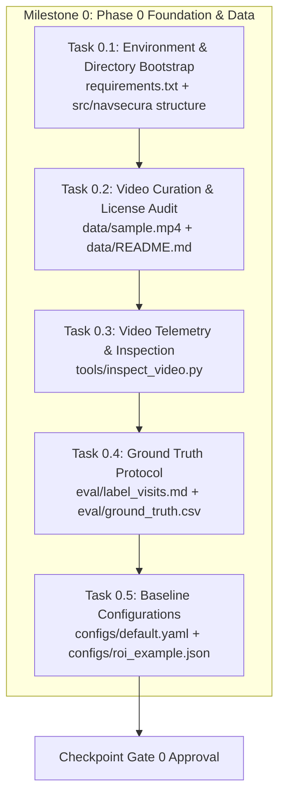

# Milestone 0 (M0): Foundation, Environment, Data Curation & Ground Truth Protocol

> **Project:** NavSecura Computer Vision Engineering Assessment — Video Understanding, Tracking and Event Memory  
> **Associated Phase:** Phase 0 (Foundation and Data)  
> **Target Standard:** 10/10 Code Quality, Empirical Rigor, and Zero-Defect Asset Verification  
> **Active Skills / Agents:** [`navsecura-submission`](file:///Users/jayesh/Documents/opencv/.agents/skills/navsecura-submission/SKILL.md), [`cv-tracker-evaluator`](file:///Users/jayesh/Documents/opencv/.agents/skills/cv-tracker-evaluator/SKILL.md), [`visit-event-guard`](file:///Users/jayesh/Documents/opencv/.agents/skills/visit-event-guard/SKILL.md)  
> **Authoritative References:** [docs/plan.md](file:///Users/jayesh/Documents/opencv/docs/plan.md), [docs/requirements.md](file:///Users/jayesh/Documents/opencv/docs/requirements.md), [instruction.md](file:///Users/jayesh/Documents/opencv/instruction.md)

---

## 1. Executive Summary & Milestone Objectives

The objective of **Milestone 0 (Phase 0)** is to establish a rock-solid, fully reproducible engineering foundation before executing model inference or tracking algorithms.

Conventional computer vision projects fail at evaluation because ground truth is ambiguously defined, dependencies are unpinned, or test videos lack targeted edge cases. Milestone 0 eliminates these risks by:
1. Bootstrapping the modular repository architecture and pinned runtime environment.
2. Curating and validating a CCTV-style video clip that specifically exercises the 5 primary tracking failure modes (**F1–F5**).
3. Documenting strict model, dataset, and video licensing provenance in `data/README.md`.
4. Defining a mathematically precise, human-annotated Ground Truth Visit Protocol in `eval/label_visits.md` and `eval/ground_truth.csv`.
5. Delivering automated video stream inspection telemetry via `tools/inspect_video.py`.
6. Initializing baseline system configurations (`configs/default.yaml`, `configs/roi_example.json`).

---

## 2. Milestone Exit Criteria (Definition of Done)

Milestone 0 is complete when all of the following gates are cleared:

- [ ] **Environment Pinned:** `requirements.txt` specifies exact library versions compatible with Python 3.10+ (Apple Silicon & Linux x86).
- [ ] **Directory Layout Complete:** Modular hierarchy created matching `src/navsecura/` architecture.
- [ ] **Test Video Verified:** Video file verified for resolution, constant FPS, codec compatibility, and ground plane visibility.
- [ ] **Licensing Disclosed:** Third-party licenses documented in `data/README.md` (ensuring non-commercial or proprietary footage restrictions are strictly avoided).
- [ ] **Scenario Coverage:** Video contains at least 3–5 visits demonstrating:
  - Normal entrance and dwell.
  - Brief occlusion (pillar, crossing pedestrian).
  - Walk-through without lingering.
  - Boundary lingering / edge walking.
  - Exit and subsequent re-entry.
- [ ] **Ground Truth Annotated:** `eval/ground_truth.csv` hand-annotated with start/exit timestamps (seconds and frame indices) per visit.
- [ ] **Inspection Tool Operational:** `tools/inspect_video.py` outputs JSON video stream properties and confirms no dropped frames.
- [ ] **Initial Configs Committed:** `configs/default.yaml` and `configs/roi_example.json` populated with baseline parameters.

---

## 3. Detailed Work Breakdown & Implementation Steps



---

### Task 0.1: Repository Layout & Dependency Specification

1. **Modular Directory Structure:**
   ```
   .
   ├── configs/
   │   ├── default.yaml             # Baseline thresholds, model selection, grace periods
   │   └── roi_example.json         # Polygon vertices in pixel coordinates
   ├── data/
   │   ├── README.md                # Video provenance, license, resolution/fps metadata
   │   └── sample.mp4               # Target test video (or download script)
   ├── eval/
   │   ├── ground_truth.csv         # Hand-annotated visit timestamps & ground truth
   │   ├── label_visits.md          # Ground truth annotation methodology & rules
   │   └── evaluate.py              # Metric calculation script (Phase 4)
   ├── src/
   │   └── navsecura/
   │       ├── __init__.py
   │       ├── io/                  # Video capture, timestamps, circular ring buffer
   │       ├── detect/              # Detector abstract protocol & YOLO/RF-DETR adapters
   │       ├── track/               # Tracker abstract protocol & ByteTrack/BoT-SORT
   │       ├── roi/                 # Foot-point math, polygon ray-casting, hysteresis
   │       ├── events/              # Visit state machine, ID stitching, event models
   │       ├── store/               # SQLite persistence (WAL mode), JSON/CSV export
   │       ├── evidence/            # Snapshot extractor, pre-roll clip writer
   │       ├── analytics/           # Streaming hour-of-week baselines, anomaly scoring
   │       └── cli.py               # Unified CLI interface
   ├── tests/
   │   ├── __init__.py
   │   ├── test_roi.py              # Unit tests for polygon containment & foot-point
   │   └── test_state_machine.py    # Synthetic track unit tests (F1-F8 failure modes)
   ├── tools/
   │   ├── inspect_video.py         # Stream telemetry inspector (resolution, FPS, codec)
   │   ├── draw_roi.py              # Interactive OpenCV polygon ROI drawer
   │   └── make_demo.py             # Visual overlay demonstration generator
   ├── docs/
   │   ├── plan.md                  # Master research, architecture & execution plan
   │   ├── requirements.md          # NavSecura formal assessment brief
   │   ├── antigravity_skill.md     # Antigravity skill specification & master prompt
   │   ├── instruction.md           # Master engineering protocol & operating rules
   │   ├── engineering_discussion.md# Written engineering discussion (Phases 5-6)
   │   └── limitations.md           # Authentic failure mode write-up (Phase 6)
   ├── instruction.md               # Root symlink/copy of master engineering protocol
   ├── AGENTS.md                    # Antigravity agent role definitions & workspace rules
   └── requirements.txt             # Pinned package versions
   ```

2. **Pinned `requirements.txt`:**
   Dependencies must balance real-time edge execution with zero bloat:
   ```txt
   # Core Computer Vision & Deep Learning
   ultralytics>=8.3.0
   opencv-python>=4.10.0.84
   torch>=2.2.0
   torchvision>=0.17.0
   numpy>=1.26.0,<2.0.0
   scipy>=1.11.0

   # Geometry & Polygon Spatial Operations
   shapely>=2.0.0

   # Configuration & Data Handling
   pyyaml>=6.0.1
   pydantic>=2.7.0

   # Testing & Tooling
   pytest>=8.0.0
   matplotlib>=3.8.0
   tqdm>=4.66.0
   ```

---

### Task 0.2: Video Selection, Provenance & Licensing Verification

1. **Dataset Selection Criteria:**
   - Must be fixed-camera CCTV angle (mounted overlooking entrance, hallway, or showroom).
   - Ground plane must be visible (allowing foot-point contact detection).
   - High enough resolution (min 720p / 1080p preferred) and clean frame rate (20–30 FPS).
   - Free of legal encumbrances: CC-BY, Public Domain, MOTChallenge research-licensed, or self-recorded.
   - Strictly avoid proprietary, confidential, or private commercial footage.

2. **Scenario Scripting (Failure Modes F1–F5 Coverage):**
   The chosen video clip (1–3 minutes) must contain:
   | Failure Mode | Scenario within Video Clip | What It Exercises |
   |---|---|---|
   | **Nominal Transit** | Person walks into ROI, lingers for 15s, exits cleanly | Validates entry detection, dwell measurement, and single event emission |
   | **F1 (Detector Dropout)** | Person detected, misses 2–3 frames due to lighting/motion | Validates that grace period absorbs drops without splitting the visit |
   | **F2 (Brief Occlusion)** | Person passes behind a pillar or another walking person | Validates ByteTrack low-score association and state machine grace timer |
   | **F3 (Pedestrian Crossing)** | Two individuals cross paths inside or near the ROI | Stresses ID-switch dynamics and spatio-temporal association |
   | **F4 (Boundary Lingering)** | Person walks back and forth right along the ROI boundary | Validates that entry/exit hysteresis stops event flickering |
   | **F5 (Exit & Re-entry)** | Person exits ROI, returns 15 seconds later | Validates policy: separate visit linked via `parent_visit_id` |

3. **Deliverable:** `data/README.md` documenting clip source, exact download URL or recording setup, license, resolution, FPS, and MD5 hash.

---

### Task 0.3: Video Stream Inspection & Telemetry Tool (`tools/inspect_video.py`)

Create a diagnostic tool to deeply inspect the video container before pipeline execution:
- Verify container format (MP4/H.264), width, height, aspect ratio.
- Measure actual FPS vs header FPS (detecting variable frame rate issues).
- Confirm total frame count and duration in seconds.
- Test sequential read throughput and confirm zero decoded frame corruption.

**Usage:**
```bash
python tools/inspect_video.py --video data/sample.mp4 --output outputs/video_meta.json
```

---

### Task 0.4: Ground Truth Visit Protocol & Hand-Annotation

To evaluate visit precision, recall, and dwell accuracy objectively, ground truth cannot be an afterthought:

1. **Visit Ground Truth Definition:**
   - **ROI Ground Plane Rule:** An individual is considered *inside* the ROI if and only if their ground plane contact point (feet) is within the defined polygon coordinates.
   - **Entry Instant ($t_{\text{enter}}$):** The exact timestamp (and frame number) the foot point crosses into the polygon.
   - **Exit Instant ($t_{\text{exit}}$):** The exact timestamp (and frame number) the foot point completely leaves the polygon.
   - **True Dwell Time ($\Delta t$):** $\Delta t = t_{\text{exit}} - t_{\text{enter}}$.
   - **Re-Entry Threshold:** Any absence $> 5.0\text{s}$ is treated as a separate distinct visit.

2. **Annotation Schema (`eval/ground_truth.csv`):**
   ```csv
   visit_id,person_id,frame_enter,frame_exit,t_enter_s,t_exit_s,duration_s,roi_id,notes
   V01,P1,120,450,4.80,18.00,13.20,roi_entrance,nominal visit
   V02,P2,300,520,12.00,20.80,8.80,roi_entrance,brief occlusion behind pillar
   V03,P3,610,980,24.40,39.20,14.80,roi_entrance,crosses path with P4
   V04,P4,640,890,25.60,35.60,10.00,roi_entrance,crosses path with P3
   V05,P1,1200,1550,48.00,62.00,14.00,roi_entrance,re-entry of person P1
   ```

3. **Annotation Guide (`eval/label_visits.md`):** Complete protocol explaining how annotations were derived, edge cases handled, and how human labeler disagreement is resolved.

---

### Task 0.5: Baseline Configurations (`configs/default.yaml`)

Define all production defaults and thresholds in a centralized, documented configuration:

```yaml
# configs/default.yaml
pipeline:
  name: "navsecura-video-analytics"
  version: "1.0.0"
  random_seed: 42

video:
  source: "data/sample.mp4"
  camera_id: "cam_entrance_01"
  target_fps: null # null uses native FPS

detector:
  model_type: "yolo" # options: "yolo", "rfdetr"
  weights: "yolo11n.pt" # lightweight for CPU; use yolo11s.pt or yolo11m.pt for GPU
  confidence_threshold: 0.35
  iou_threshold: 0.70
  classes: [0] # 0 = person in COCO
  device: "cpu" # "cpu", "cuda", "mps"

tracker:
  type: "bytetrack" # options: "bytetrack", "botsort"
  track_high_thresh: 0.50
  track_low_thresh: 0.10
  new_track_thresh: 0.60
  match_thresh: 0.80
  track_buffer: 30 # frames to keep lost tracks alive

roi:
  config_path: "configs/roi_example.json"
  foot_point_position: "bottom_center" # (x1+x2)/2, y2

events:
  enter_consecutive_frames: 3 # hysteresis: frames inside before opening visit
  grace_period_s: 2.0 # seconds to hold visit open on lost detection
  min_dwell_s: 1.0 # filter transient false positives shorter than this
  stitching:
    enabled: true
    max_time_gap_s: 5.0
    max_distance_px: 150.0

store:
  db_path: "outputs/events.db"
  wal_mode: true

evidence:
  output_dir: "outputs"
  save_snapshots: true
  save_clips: true
  pre_roll_s: 3.0 # seconds of footage before entry
  post_roll_s: 3.0 # seconds of footage after entry
```

---

## 4. Phase Checkpoint Gate (M0 $\rightarrow$ M1)

Before proceeding to **Milestone 1 (Detection & Tracking Baseline)**, compile and present the milestone checkpoint formal report:

```markdown
### Checkpoint Formalism: Milestone 0
- **DONE:**
  - Complete repository layout initialized.
  - Dependencies pinned in `requirements.txt`.
  - Sample video acquired and verified with `tools/inspect_video.py`.
  - Video provenance and license documented in `data/README.md`.
  - Ground truth visits hand-annotated in `eval/ground_truth.csv`.
  - Baseline configs established in `configs/default.yaml` and `configs/roi_example.json`.
- **EVIDENCE:**
  - Telemetry output: `outputs/video_meta.json`.
  - File link: [eval/ground_truth.csv](file:///Users/jayesh/Documents/opencv/eval/ground_truth.csv).
  - File link: [data/README.md](file:///Users/jayesh/Documents/opencv/data/README.md).
- **NEXT:**
  - Milestone 1: Perception Baseline (Detector protocol, Tracker protocol, YOLO + ByteTrack integration, visual verification).
- **RISKS & GAPS:**
  - Assess CPU inference latency on selected video resolution.
  - Verify if detector misses distant people in the background.
```

---

*This specification governs Milestone 0 execution. Proceed with Task 0.1 implementation.*

