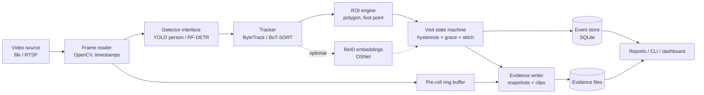
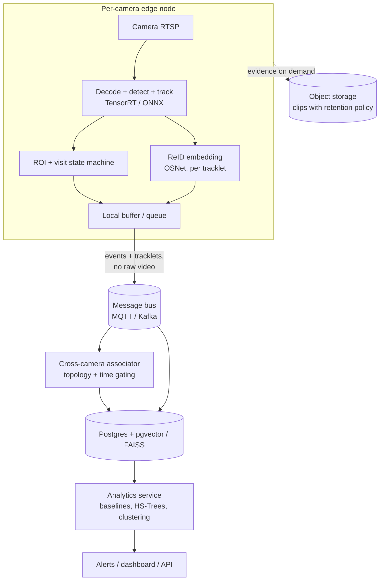

# NavSecura CV Assessment: Research, Architecture and Execution Plan

**Project:** Video understanding, tracking and event memory
**Goal:** Turn frame-by-frame person detections into **one coherent event per visit**, with a production-minded design and an honest engineering discussion.
**Last researched:** 6 Nov 2026

> **Source legend.** Items marked **[verified]** were checked against a source during research. Items marked **[†]** come from background knowledge and should be re-checked before you cite them in the README. Licence terms in particular must be confirmed on the original pages before submission.

---

## 1. The Actual Problem

### 1.1 What NavSecura is asking for
Conventional video analytics emits an alert on *every frame* a person is detected. One person standing in a doorway for 10 s at 25 FPS yields about 250 alerts. Operators drown in noise, and nothing tells them *who* did *what* for *how long*.

The assessment asks for a small prototype that:

1. Detects people (open-source model).
2. Tracks them with temporary IDs.
3. Defines a Region of Interest (ROI).
4. Records **entry time** and **dwell time** per person.
5. Emits **one event per visit**.
6. Persists an event history: timestamp, track ID, duration, frame or clip reference.

Plus a written discussion (approach choice, occlusion/re-entry, multi-camera, pattern learning), a demo, a repo with attribution, and a limitation write-up.

### 1.2 What is really being evaluated
The brief says: *"engineering judgement, clarity of reasoning and the working implementation."* The detector and tracker are commodity components. The differentiators are:

| Real challenge | Why it matters |
|---|---|
| **Event semantics** (what counts as a "visit") | This is the core product logic, and it is not solved by any library. |
| **Robustness to tracker imperfection** | Trackers flicker, drop, and switch IDs. Event logic must absorb that. |
| **Honest evaluation** | MOT metrics measure tracks. The product cares about *visits*. |
| **Production thinking** | Licensing, privacy, storage, scaling, drift, multi-camera. |
| **Clear failure analysis** | The brief explicitly asks for a limitation you hit. |

### 1.3 Failure modes the design must address

| # | Failure mode | Effect on events |
|---|---|---|
| F1 | Detector misses a person for a few frames | Visit split into two |
| F2 | Brief occlusion (pillar, another person) | Track lost, new ID on reappearance, duplicate visit |
| F3 | ID switch between two crossing people | Visit attributed to the wrong track, wrong dwell |
| F4 | Person walks along the ROI boundary | Enter/exit flicker, event spam |
| F5 | Person leaves and returns minutes later | Should this be one visit or two? (policy decision) |
| F6 | False positive detection (mannequin, poster, reflection) | Phantom visit |
| F7 | Video ends or stream drops while a visit is open | Orphaned open visit |
| F8 | Crowd, small distant people | Low recall, ID churn |

---

## 2. Research Synthesis

### 2.1 Paradigm: tracking-by-detection
The dominant practical approach is to run a detector on each frame and associate detections across frames. This is what ByteTrack, BoT-SORT, SORT/DeepSORT, StrongSORT and OC-SORT all do. It lets you swap the detector without touching the tracker. That separation is the main reason to use it in production.

### 2.2 Detector options

| Option | Strengths | Weaknesses | Licence | Verdict |
|---|---|---|---|---|
| **Ultralytics YOLO** (YOLO11 / YOLO26 family) | Excellent tooling, built-in tracking, easy export (ONNX, TensorRT), strong CPU/edge speed | **AGPL-3.0**: commercial deployment needs a paid licence or open-sourcing derivative work **[verified]** | AGPL-3.0 | **Best for the assessment prototype.** Document the licence. |
| **RF-DETR** (Roboflow, ICLR 2026) | Transformer detector, exceeds 60 AP on COCO, designed for domain adaptability **[verified]** | Heavier on CPU than small YOLO | Code Apache 2.0. Weights: Nano/Small/Medium/Large Apache 2.0; some sizes (Atto, Femto, Pico, XL, 2XL) under Roboflow's Platform Model License **[verified]** | **Best production-licence alternative.** Use as the "swap-in" proof of detector independence. |
| **RT-DETR / RT-DETRv2** (Baidu) | First transformer detector to reach real-time speed; stable PyTorch/ONNX/TensorRT pipelines **[verified]** | Slightly older than RF-DETR | Apache 2.0 **[verified]** | Solid permissive baseline. |
| **YOLOX** (Megvii) | Apache 2.0, the detector used by the ByteTrack reference code **[verified]** | Older, less active | Apache 2.0 | Good if you follow ByteTrack's reference pipeline. |
| YOLO-NAS | Competitive accuracy | Weights under a non-commercial licence **[verified]** | Custom | Avoid. |

**Decision:** Ultralytics YOLO (person class only, COCO-pretrained) for the primary prototype, behind a thin `Detector` interface. Add an RF-DETR adapter as a stretch goal to demonstrate that the licence-sensitive part is replaceable.

### 2.3 Tracker options

| Tracker | Core idea | Evidence | Fit |
|---|---|---|---|
| **ByteTrack** (ECCV 2022) | Associates *almost every* detection box: first match high-score boxes, then use low-score boxes to rescue unmatched tracklets, which recovers occluded people instead of discarding them **[verified]** | MOT17: 80.3 MOTA, 77.3 IDF1, 63.1 HOTA, ~30 FPS on a V100 **[verified]** | Excellent for **static CCTV**. Fast, simple, no appearance model needed. |
| **BoT-SORT** (2022) | Fuses motion and appearance, adds **camera-motion compensation** and a better Kalman state vector; optional ReID **[verified]** | MOT17: 80.5 MOTA, 80.2 IDF1, 65.0 HOTA (BoT-SORT-ReID) **[verified]** | Better for moving cameras and for survival through occlusion (with ReID). Ultralytics default. |
| **SORT / DeepSORT** † | Kalman + Hungarian matching; DeepSORT adds an appearance embedding | Foundational, widely cited | Baseline for comparison, not the best choice today. |
| **StrongSORT / OC-SORT** † | Appearance upgrades / observation-centric corrections for non-linear motion | Strong on DanceTrack-style motion | Useful only if motion is erratic. |

Ultralytics ships both ByteTrack and BoT-SORT via `tracker=bytetrack.yaml` / `botsort.yaml`. BoT-SORT is the default, and `with_reid: True` enables appearance matching, which is off by default to save compute **[verified]**.

**Decision:** Run **both** on the same video and compare, because the comparison *is* your engineering-judgement evidence.
- **Primary:** ByteTrack, because CCTV cameras are fixed, so camera-motion compensation adds cost without benefit, and ByteTrack's low-confidence rescue targets exactly the occlusion failure (F2).
- **Comparison:** BoT-SORT with ReID enabled, to show what appearance buys you under occlusion and what it costs in FPS.

### 2.4 Re-identification (appearance embeddings)
- **OSNet** (Zhou et al., ICCV 2019) is a lightweight ReID network that learns omni-scale features. It is over an order of magnitude smaller than ResNet50-based models yet reaches state-of-the-art on six datasets **[verified]**. The authors also note that for large surveillance deployments, running feature extraction at the camera end is the practical design **[verified]**. This is relevant to the multi-camera architecture.
- **OSNet-IBN/AIN** adds instance normalisation for **domain generalisation**, so a model trained on source datasets can be applied to an unseen target without retraining **[verified]**. This directly supports the "no daily retraining" requirement.
- **FastReID** † is the toolbox BoT-SORT's ReID builds on **[verified that BoT-SORT builds on it]**.

**Decision:** Use a pretrained OSNet (via `torchreid` or `boxmot`, check licences) for track-stitching and cross-camera discussion. Keep it optional so the base pipeline runs without it.

### 2.5 Multi-camera tracking (MTMC)
Findings from the AI City Challenge literature:
- Appearance alone is insufficient under heavy occlusion. Winning systems in 2023 and 2024 relied on **spatio-temporal constraints** **[verified, via a 2026 paper's survey of related work]**.
- Top teams in earlier editions used **scene topology** to rule out infeasible cross-camera transitions **[verified]**. Some used only camera adjacency, others modelled transit times.
- A representative 2023 system used OSNet-family ReID models (OSNet, OSNet-IBN, OSNet-AIN) with features concatenated for both single- and multi-camera association **[verified]**.
- A 2024 online framework used a three-stage pipeline: single-camera MOT, multi-camera association, and cross-interval synchronisation across time windows **[verified]**.

**Design takeaway:** Cross-camera association = appearance similarity **gated** by a camera-topology graph and transit-time windows, solved as clustering or assignment over short time windows.

### 2.6 Learning recurring patterns without retraining
Principle: **freeze the perception model, learn on the structured events it emits.** The neural network is a sensor, and the "learning" happens on cheap statistics over event data.

| Technique | What it learns | Why it avoids retraining |
|---|---|---|
| **Hour-of-week count baselines** (Poisson / Gamma-Poisson per camera x ROI x hour-of-week) | Normal visit volume | Closed-form updates |
| **Dwell-time distributions** (EWMA + quantiles, or log-normal fit) | Normal stay length | Streaming statistics |
| **Streaming Half-Space Trees** (Tan, Ting, Liu, IJCAI 2011) | Anomalous feature vectors (hour, dwell, speed, ROI) | One-class, needs only normal data, tree structure built without data, constant memory, no restructuring on drift **[verified]** |
| **Offline clustering** (HDBSCAN or k-means on trajectory/embedding features, nightly job) | Recurring routes and visitor "types" | A batch job on stored events, not on pixels |
| **Vector index of embeddings** (FAISS / pgvector) | Repeat visitors, cross-camera links | Nearest-neighbour search, no training |
| **Drift handling** (sliding windows, seasonal baselines) | Changing behaviour | Windows roll forward automatically |

A periodic **fine-tune of the detector** is only triggered by a *data-quality* signal (for example, a falling mean detection confidence or a rising ID-switch rate), never by a schedule.

### 2.7 Evaluation methodology
- **HOTA** † and **IDF1** are the standard tracking metrics; MOTChallenge provides the benchmark protocols and TrackEval is the reference code **[MOTChallenge verified]**.
- Tracker metrics do not measure what the product cares about. Add **visit-level metrics** (Section 7).

### 2.8 Data options

| Dataset | Notes | Action |
|---|---|---|
| **Self-recorded clip** | Cleanest licence, full control, can be shaped to show occlusion and re-entry | **Recommended primary** |
| **MOT17 / MOT20** (MOTChallenge) | Standard pedestrian benchmark with ground truth **[verified]** | Use for tracker metric validation. **Check the licence on motchallenge.net before redistributing; I could not confirm terms.** Do not commit the data to your repo, link to it instead. |
| PETS2009, Oxford Town Centre, VIRAT † | Surveillance-style | Check each licence before use |

---

## 3. Solution Approach

### 3.1 Design principles
1. **Separate concerns.** Detector, tracker, ROI logic, event store and evidence capture are independent modules with narrow interfaces.
2. **Events are derived state, not detections.** The visit state machine is the product.
3. **Be tolerant of tracker noise.** Hysteresis, grace periods and ID stitching live in the event layer, so the tracker can be swapped.
4. **Evidence over assertion.** Every event links to a snapshot and a short clip.
5. **Reproducible.** Pinned versions, fixed seeds, a one-command demo, documented configs.
6. **Privacy-aware.** Temporary IDs only, no face recognition, configurable retention, embeddings treated as personal data.

### 3.2 Key design decisions

| Decision | Choice | Rationale |
|---|---|---|
| ROI membership test | **Foot point** (bottom-centre of bbox) inside polygon | Torso/centroid tests misfire with perspective. Feet are on the ground plane. |
| Enter/exit stability | **Hysteresis**: require N consecutive in-ROI frames to open, and M frames (or T seconds) out to close | Kills boundary flicker (F4). |
| Detection dropouts | **Grace period** (default 2 s) before closing a visit | Absorbs F1 and short F2. |
| Minimum visit | Drop visits shorter than `min_dwell` (default 1 s) | Suppresses transient false positives (F6). |
| Time base | Video timestamps (`frame_idx / fps`) plus an optional wall-clock start | Makes results reproducible offline and correct for live. |
| Emit moment | Emit on **close**, with an optional "visit opened" notification carrying the same `visit_id` | One coherent record per visit, plus low-latency alerting if needed. |
| ID stitching | If a track ends and a new track begins in/near the ROI within `stitch_window` with similar appearance and plausible position, **merge into the same visit** | Handles F2/F3 without relying on tracker identity. |
| Storage | **SQLite** (WAL mode) plus files on disk; JSON export | Zero-ops, transactional, queryable, and migrates cleanly to Postgres. |
| Evidence | Entry snapshot, peak-confidence snapshot, and a clip using a **pre-roll ring buffer** (about 3 s before, 3 s after) | Operators see the moment of entry, not just after. |

### 3.3 Visit state machine (per track)

```
          in-ROI for >= enter_frames
 OUTSIDE ───────────────────────────────► INSIDE (visit opened, t_enter)
    ▲                                        │
    │                                        │ out-of-ROI or track missing
    │                                        ▼
    │                                   GRACE (timer starts)
    │      back in ROI before timeout        │
    │◄───────────────────────────────────────┤ (return to INSIDE, same visit)
    │                                        │ timeout >= grace_s
    │                                        ▼
    └──────────────────────────────────── CLOSED
                         (duration = t_last_seen_inside - t_enter;
                          emit if duration >= min_dwell)
```

Rules:
- `duration` is measured to the **last time the person was actually seen inside**, not to the end of the grace timer, so dwell is not inflated.
- On end-of-stream, force-close every open visit with `close_reason = "stream_end"` (F7).
- Every closed visit records `close_reason` (`exited`, `track_lost`, `stream_end`, `merged`).

### 3.4 Handling the engineering-discussion questions (draft answers)

**Why this detection and tracking approach?**
Tracking-by-detection with a pretrained COCO person detector gives strong accuracy with no training. ByteTrack is chosen for fixed CCTV because its two-stage association rescues low-confidence (often occluded) detections instead of discarding them, achieving 80.3 MOTA / 77.3 IDF1 on MOT17 at real-time speed. BoT-SORT with ReID is the comparison to quantify what appearance matching buys. The event layer sits above the tracker, so either can be swapped. The detector sits behind an interface because the YOLO licence (AGPL-3.0) matters for commercial use, and RF-DETR or RT-DETR (Apache 2.0) are drop-in alternatives.

**What happens under occlusion, or when a person leaves and re-enters?**
Three layers:
1. *Tracker layer:* the Kalman filter predicts position through short gaps, and ByteTrack's low-score rescue plus the track buffer keep identity.
2. *Event layer:* the grace period keeps a visit open through short dropouts, and the minimum-dwell filter removes noise.
3. *Stitching layer:* if identity is lost anyway, a new track that starts near where the old one ended, within the stitch window, with a similar appearance embedding, is merged into the same visit.
For leave-and-re-enter, the policy is explicit and configurable: gaps shorter than `grace_s` are one visit, gaps up to `stitch_window` with a strong appearance match are a *re-entry* linked to the previous visit (`parent_visit_id`), and anything longer is a new visit. Temporary IDs are never claimed to identify a person across long gaps.

**How to extend across cameras covering different areas of one site?**
Per-camera edge pipelines emit tracklets (box trajectory plus a few averaged ReID embeddings, not video). A central service holds a **camera topology graph** (which cameras connect, with min/max transit times) and associates tracklets across cameras using appearance similarity **gated by topology and time**, solved by assignment or clustering over sliding time windows, as in AI City Challenge MTMC systems. Cameras need synchronised clocks (NTP/PTP) and a shared ID scheme (`global_id` mapped to `(camera_id, track_id)`). Embeddings go into a vector index. Domain-generalised ReID (OSNet-IBN/AIN) reduces cross-camera appearance shift.

**How can it learn recurring patterns without daily neural retraining?**
Keep the neural networks frozen and learn on events. Maintain hour-of-week baselines of visit counts and dwell distributions per ROI, score each new visit against them, run a streaming one-class detector (Half-Space Trees) over event feature vectors for unusual behaviour, and run a nightly batch clustering job over stored trajectories and embeddings to discover recurring routes. Detector fine-tuning is triggered only by measured data-quality drift.

---

## 4. System Architecture

### 4.1 Logical architecture (prototype)



### 4.2 Module map

```
navsecura-assessment/
├── README.md                    # setup, usage, attribution, limitation write-up
├── LICENSE
├── requirements.txt             # pinned versions
├── pyproject.toml               # optional
├── configs/
│   ├── default.yaml             # thresholds, grace_s, min_dwell, tracker choice
│   └── roi_example.json         # polygon(s) in pixel coords
├── src/navsecura/
│   ├── io/video.py              # frame reader, fps, timestamps, ring buffer
│   ├── detect/base.py           # Detector protocol
│   ├── detect/yolo.py           # Ultralytics adapter
│   ├── detect/rfdetr.py         # optional adapter
│   ├── track/base.py            # Tracker protocol
│   ├── track/ultralytics_trk.py # ByteTrack / BoT-SORT wrapper
│   ├── roi/polygon.py           # point-in-polygon, foot point, hysteresis
│   ├── events/state_machine.py  # per-track visit lifecycle
│   ├── events/stitch.py         # ID stitching / re-entry linking
│   ├── events/models.py         # Visit dataclass / schema
│   ├── store/sqlite.py          # persistence, export to JSON/CSV
│   ├── evidence/clip.py         # snapshots, pre-roll clips
│   ├── analytics/baselines.py   # hour-of-week stats, anomaly scoring
│   └── cli.py                   # run / report / export commands
├── tools/
│   ├── draw_roi.py              # click-to-define polygon
│   └── make_demo.py             # annotated output video
├── tests/                       # state machine + ROI unit tests (synthetic tracks)
├── eval/
│   ├── label_visits.md          # how ground truth was annotated
│   ├── ground_truth.csv
│   └── evaluate.py              # visit-level metrics + optional TrackEval
├── data/README.md               # video source, licence, download instructions
├── outputs/                     # events.db, events.json, snapshots/, clips/
└── docs/
    ├── engineering_discussion.md
    ├── architecture.md
    └── limitations.md
```

### 4.3 Data model (SQLite)

```sql
CREATE TABLE visits (
  visit_id          TEXT PRIMARY KEY,         -- uuid
  camera_id         TEXT NOT NULL,
  roi_id            TEXT NOT NULL,
  track_id          INTEGER NOT NULL,         -- temporary tracker ID
  merged_track_ids  TEXT,                     -- JSON list if stitched
  parent_visit_id   TEXT,                     -- set for re-entry links
  entered_at        TEXT NOT NULL,            -- ISO-8601 wall clock
  exited_at         TEXT NOT NULL,
  video_t_enter_s   REAL NOT NULL,            -- seconds from video start
  video_t_exit_s    REAL NOT NULL,
  frame_enter       INTEGER NOT NULL,
  frame_exit        INTEGER NOT NULL,
  duration_s        REAL NOT NULL,
  mean_conf         REAL,
  close_reason      TEXT NOT NULL,            -- exited|track_lost|stream_end|merged
  snapshot_entry    TEXT,                     -- relative path
  snapshot_peak     TEXT,
  clip_path         TEXT,
  config_hash       TEXT NOT NULL,            -- reproducibility
  model_version     TEXT NOT NULL
);
CREATE INDEX idx_visits_time ON visits(camera_id, roi_id, entered_at);
```

### 4.4 Production target architecture (for the discussion, not to build)



Production concerns to name in the write-up: GPU/edge sizing, clock sync (NTP/PTP), back-pressure and local buffering on network loss, model and config versioning, evidence retention and privacy policy, monitoring (FPS, detection-confidence drift, ID-switch proxy), and the AGPL-versus-Apache licensing decision.

---

## 5. Milestones and Phases

Timeline assumes roughly 6 to 8 focused working days. Compress or stretch as the deadline requires. Phases 0 to 4 are the **must-have** core. Phases 5 and 6 are what separate a good submission from a great one.

### Phase 0: Foundation and Data (Day 1)
| Task | Output |
|---|---|
| Create repo, environment, pinned `requirements.txt` | Reproducible setup |
| Choose the video: record a 1 to 3 min self-recorded clip, or pick a licensed public clip | `data/README.md` with source and licence |
| Script the clip to include: normal entry/exit, a brief occlusion, a leave-and-return, two people crossing, someone lingering at the ROI edge | A video that exercises F1 to F5 |
| Define ground truth plan (who enters when) | `eval/label_visits.md` |

**Exit criteria:** video plays, licence is documented, expected visits are hand-listed.

### Phase 1: Detection and Tracking Baseline (Day 2)
| Task | Output |
|---|---|
| `Detector` and `Tracker` interfaces | Clean module boundaries |
| YOLO person-only adapter, ByteTrack via Ultralytics | Tracks with IDs per frame |
| Render annotated video (boxes, IDs, trajectories) | First visual sanity check |
| Log FPS, mean confidence | Baseline numbers |

**Exit criteria:** stable IDs on the clip, annotated video produced.

### Phase 2: ROI and Visit Logic (Days 3 to 4), the core milestone
| Task | Output |
|---|---|
| Polygon ROI tool and config | `configs/roi_example.json` |
| Foot-point membership with hysteresis | No boundary flicker |
| Per-track state machine (OUTSIDE/INSIDE/GRACE/CLOSED) | One visit per track visit |
| Force-close on stream end | No orphaned visits |
| **Unit tests with synthetic tracks** (dropouts, boundary jitter, ID gaps) | Proof the logic is correct independent of the model |

**Exit criteria:** on the demo clip, the number of emitted visits matches the hand-labelled count, and the unit tests pass.

### Phase 3: Persistence and Evidence (Day 4 to 5)
| Task | Output |
|---|---|
| SQLite store and schema, JSON/CSV export | `events.db`, `events.json` |
| Entry and peak snapshots | `snapshots/` |
| Pre-roll ring buffer and short clips | `clips/` |
| CLI: `run`, `report`, `export` | One-command demo |

**Exit criteria:** every event has a timestamp, track ID, duration and a working evidence link.

### Phase 4: Robustness, Stitching and Evaluation (Day 5 to 6)
| Task | Output |
|---|---|
| ID-stitching and re-entry linking (appearance optional, spatial/temporal baseline first) | Fewer duplicate visits |
| ByteTrack vs BoT-SORT(+ReID) comparison | Table: visit precision/recall, fragmentation, FPS |
| Visit-level evaluation script | `eval/evaluate.py`, results table |
| Parameter sensitivity (`grace_s`, `min_dwell`) | Small ablation chart |

**Exit criteria:** quantitative comparison produced, and the improvement from stitching is measured.

### Phase 5: Pattern Learning Layer (Day 6 to 7), stretch
| Task | Output |
|---|---|
| Hour-of-week baseline and z-score per ROI | `analytics/baselines.py` |
| Dwell-time anomaly flag | Example flagged visit |
| Optional Half-Space Trees over event features | Streaming anomaly demo |
| Short design note for nightly clustering | `docs/` section |

Note: a single short clip has no real "weeks" of history. Demonstrate the mechanism on **simulated** event history and label it clearly as simulated.

**Exit criteria:** the mechanism runs end to end and its limits are stated honestly.

### Phase 6: Documentation and Demo (Day 7 to 8)
| Task | Output |
|---|---|
| README: setup, usage, config, attribution (models, libraries, data, licences) | Complete README |
| `engineering_discussion.md` (use Section 3.4 as the base, keep it concise) | The written part of the brief |
| `limitations.md`: one real failure you observed, its cause, what you would improve | The required limitation section |
| 2 to 4 minute demo video | Annotated video plus event table on screen |
| Final clean-clone test on a fresh environment | Confidence that reviewers can run it |

**Exit criteria:** a stranger can clone, install and reproduce the demo in under 10 minutes.

### Milestone summary

| Milestone | Gate | Phase |
|---|---|---|
| M1 | Tracking works on the chosen clip | 1 |
| M2 | One correct visit per person on the clip, tests green | 2 |
| M3 | Persistent event history with evidence | 3 |
| M4 | Quantified comparison and stitching gain | 4 |
| M5 | Pattern-learning mechanism demonstrated | 5 |
| M6 | Repo, discussion, demo and limitation delivered | 6 |

---

## 6. Risks and Mitigations

| Risk | Likelihood | Mitigation |
|---|---|---|
| ID switches inflate or split visits | High | Event-layer stitching, grace period, report fragmentation metric |
| Poor detection on small or distant people | Medium | Larger input size or a bigger model, ROI crop inference, document the trade-off |
| Licence problems (AGPL, dataset terms) | Medium | Document in README, prefer self-recorded video, keep a detector interface, offer an Apache-2.0 alternative |
| Ground truth is subjective ("what is a visit?") | Medium | Write the visit definition down before labelling, and keep the labelling guide in the repo |
| Over-scoping (multi-camera, ML analytics) | High | Phases 0 to 4 are the contract. Everything else is described, and built only if time allows |
| Demo breaks on reviewer machine | Medium | Pinned versions, CPU-capable default model, sample output committed, clean-clone test |
| Privacy objections | Low | Temporary IDs, no face recognition, retention setting, note in README |

---

## 7. Evaluation Plan

### 7.1 Visit-level metrics (the ones that matter)
Annotate ground-truth visits (person, enter time, exit time) by hand, then match predicted visits to ground truth with a time-overlap rule.

| Metric | Definition |
|---|---|
| Visit precision | Predicted visits that match a real visit / all predicted |
| Visit recall | Real visits matched / all real visits |
| **Fragmentation rate** | Predicted visits per real visit (ideal 1.0). Measures duplicate or split events. |
| Duration error | Mean absolute difference in dwell time (s) |
| Entry-time error | Mean absolute difference in entry timestamp (s) |
| Event-reduction ratio | Frame-level alerts a naive system would have raised / visits emitted. Shows the value of the design. |

### 7.2 Tracker-level metrics (optional but credible)
If using MOT17-style ground truth, compute IDF1/HOTA with TrackEval and report them alongside visit metrics.

### 7.3 System metrics
FPS on your hardware (CPU and GPU if available), per-stage latency, memory, storage per hour of events and evidence.

### 7.4 Experiments to run
1. ByteTrack vs BoT-SORT vs BoT-SORT+ReID.
2. With vs without stitching.
3. `grace_s` sweep (0, 1, 2, 3, 5 s) against fragmentation and duration error.
4. Detector size sweep (nano vs small) against recall and FPS.

---

## 8. Final Deliverables

### 8.1 Required by the brief

| Deliverable | Contents |
|---|---|
| **Repository** | Source code, `requirements.txt`, setup instructions, configs, tests |
| **Attribution** | Model weights and libraries (name, version, licence, link), dataset source and licence, papers cited |
| **Event history** | `events.db` and `events.json` with timestamp, track ID, duration, frame/clip reference |
| **Evidence** | Snapshots and short clips referenced by events |
| **Demo** | A 2 to 4 minute recording of the working prototype: annotated video, ROI overlay, live visit counter, resulting event table |
| **Engineering discussion** | Concise answers to the four questions |
| **Limitation write-up** | One real failure you hit, the cause, and what you would improve |

### 8.2 Differentiators (high value, low cost)
- Visit-level evaluation table with ByteTrack vs BoT-SORT results.
- Unit tests that prove the state machine with synthetic tracks.
- A clearly diagrammed production architecture (Section 4.4).
- Explicit licence analysis (AGPL-3.0 versus Apache-2.0 alternatives).
- Honest scope statement: what is built, what is only designed.

### 8.3 README checklist
- [ ] One-paragraph problem statement and what the prototype does
- [ ] Architecture diagram
- [ ] Quick start (clone, install, run on the sample video)
- [ ] Config reference (ROI, thresholds)
- [ ] Output format and schema
- [ ] Results table and demo link
- [ ] Attribution and licences (models, libraries, data)
- [ ] Limitations and next steps
- [ ] Privacy note

### 8.4 Definition of done
- Clean clone installs and runs the demo with one command.
- Visit count on the demo clip matches the hand-labelled ground truth, or the differences are explained.
- Every event has a valid evidence link.
- Tests pass.
- All third-party licences are listed and none is violated.

---

## 9. Limitation to Anticipate (starter for `limitations.md`)

Do not fabricate this. Run the pipeline, observe what actually breaks, and write that. Likely candidates, in order of probability:

1. **ID switch when two people cross inside the ROI**, producing a wrong dwell time for both. *Improvement:* appearance-aware association (BoT-SORT-ReID), a stitching step with embedding checks, and a "crossing" detector that lowers confidence in dwell attribution.
2. **Visit split by a long occlusion** beyond the grace period. *Improvement:* a longer stitch window with an appearance gate, and a camera placement note.
3. **Missed small or distant people.** *Improvement:* tiled or ROI-cropped inference, a larger detector, or a camera-specific fine-tune.

---

## 10. References

**Verified during research**
- Zhang et al., *ByteTrack: Multi-Object Tracking by Associating Every Detection Box*, ECCV 2022. arXiv:2110.06864. Code: github.com/ifzhang/ByteTrack
- Aharon, Orfaig, Bobrovsky, *BoT-SORT: Robust Associations Multi-Pedestrian Tracking*, 2022. arXiv:2206.14651. Code: github.com/NirAharon/BoT-SORT
- Zhou, Yang, Cavallaro, Xiang, *Omni-Scale Feature Learning for Person Re-Identification*, ICCV 2019. arXiv:1905.00953. Code: github.com/KaiyangZhou/deep-person-reid
- Zhou et al., *Learning Generalisable Omni-Scale Representations for Person Re-Identification* (OSNet-IBN/AIN), arXiv:1910.06827
- Dendorfer et al., *MOTChallenge: A Benchmark for Single-Camera Multiple Target Tracking*, IJCV 2021. arXiv:2010.07548
- Tan, Ting, Liu, *Fast Anomaly Detection for Streaming Data* (Streaming Half-Space-Trees), IJCAI 2011, pp. 1511-1516
- *Enhancing Multi-Camera People Tracking with Anchor-Guided Clustering and Spatio-Temporal Consistency ID Re-Assignment*, arXiv:2304.09471 (AI City Challenge 2023)
- Cherdchusakulchai et al., *Online Multi-camera People Tracking with Spatial-temporal Mechanism and Anchor-feature Hierarchical*, CVPRW 2024 (AI City Challenge)
- Specker et al., *An Occlusion-aware Multi-target Multi-camera Tracking System*, CVPRW 2021
- Ultralytics docs, *Multi-Object Tracking*: docs.ultralytics.com/modes/track
- Roboflow, *RF-DETR* repository and model-licence page (roboflow.com/model-licenses/rf-detr)

**From background knowledge, re-check before citing [†]**
- Bewley et al., *Simple Online and Realtime Tracking (SORT)*, 2016. arXiv:1602.00763
- Wojke et al., *Simple Online and Realtime Tracking with a Deep Association Metric (DeepSORT)*, 2017. arXiv:1703.07402
- Du et al., *StrongSORT*, arXiv:2202.13514. Cao et al., *OC-SORT*, arXiv:2203.14360
- Zhao et al., *DETRs Beat YOLOs on Real-time Object Detection (RT-DETR)*, arXiv:2304.08069
- Luiten et al., *HOTA: A Higher Order Metric for Evaluating Multi-Object Tracking*, IJCV 2021. arXiv:2009.07736
- He et al., *FastReID*, arXiv:2006.02631
- Roboflow `supervision` library (polygon zones, time-in-zone examples). Confirm its licence before depending on it.

**Licences to confirm on the original pages before submission:** Ultralytics (AGPL-3.0), RF-DETR weights by size, MOTChallenge dataset terms, `torchreid`/`boxmot` (if used), and any public video you choose.